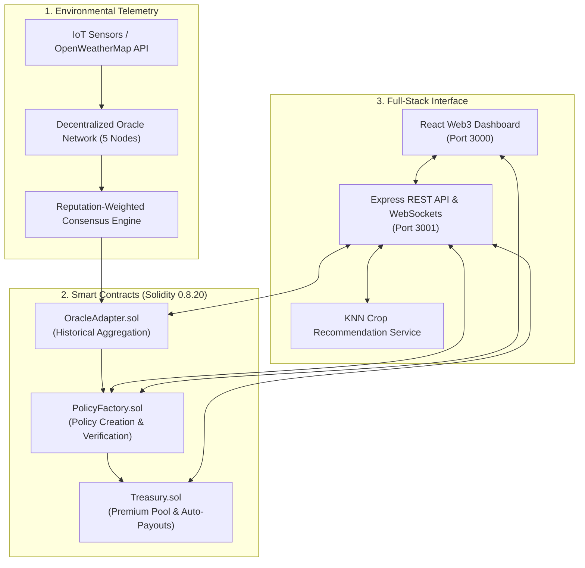

# 🌾 CropCover

> **Smart Weather Risk Insurance & Parametric Agricultural Protection**  
> Built with Ethereum (Solidity), Decentralized Oracles, IoT Simulation, Machine Learning, and React.

---

## 📌 What is CropCover?

**CropCover** is a decentralized parametric micro-insurance platform designed to protect farmers against adverse weather events (such as droughts and rainfall deficits). 

Unlike traditional crop insurance—which requires manual claim inspections, lengthy settlement delays, and high administrative fees—CropCover automates the entire lifecycle:

- **Parametric Triggers:** Policies are defined by verifiable environmental conditions (e.g., cumulative rainfall threshold during a crop window).
- **Decentralized Oracles:** A network of 5 independent oracle nodes aggregates IoT weather telemetry and external APIs using a reputation-weighted consensus mechanism.
- **Automated Payouts:** If weather conditions cross the risk threshold, Ethereum smart contracts immediately transfer claim payouts directly to the farmer's wallet without intermediaries.
- **ML Crop Advisory:** An integrated K-Nearest Neighbors (KNN) model with Min-Max feature normalization recommends optimal crops based on soil nutrients (N, P, K), pH, temperature, humidity, and rainfall.

---

## 🏗️ System Architecture



---

## 🚀 How to Run It

### Prerequisites
- [Node.js](https://nodejs.org/) (v16+)
- [MetaMask](https://metamask.io/) browser extension

---

### Option A: One-Click Quick Start (Windows)

Four automated scripts are included in the repository:

1. **Install Dependencies:**  
   Double-click `install-all.bat` (installs packages for root, backend, oracle, iot-sim, and frontend).
2. **Start Local Blockchain:**  
   Double-click `start-hardhat-node.bat` *(keep this window open)*.
3. **Deploy Smart Contracts:**  
   Double-click `deploy-contracts.bat` *(deploys contracts and creates initial products)*.
4. **Launch All Services:**  
   Double-click `start-services.bat` *(starts Backend, Oracle, IoT Simulator, and Frontend)*.

Open your browser at **`http://localhost:3000`**.

---

### Option B: Manual Setup (Terminal)

#### 1. Install Dependencies
```bash
npm install
cd backend && npm install && cd ..
cd oracle && npm install && cd ..
cd iot-sim && npm install && cd ..
cd frontend && npm install && cd ..
```

#### 2. Start Local Blockchain
```bash
# Terminal 1
npx hardhat node
```

#### 3. Deploy Contracts
```bash
# Terminal 2
npx hardhat run scripts/deploy.js --network localhost
npx hardhat run scripts/setup-demo.js --network localhost
```

#### 4. Launch Services
```bash
# Terminal 3: Backend API (Port 3001)
cd backend && npm start

# Terminal 4: Weather Oracle (Port 3002)
cd oracle && npm start

# Terminal 5: IoT Sensor Simulator
cd iot-sim && npm start

# Terminal 6: React Frontend (Port 3000)
cd frontend && npm start
```

---

### 🦊 MetaMask Setup (Localhost)

1. Open MetaMask → **Add Network** → **Add a network manually**:
   - **Network Name:** `Hardhat Localhost`
   - **RPC URL:** `http://127.0.0.1:8545`
   - **Chain ID:** `1337` *(or `31337`)*
   - **Currency Symbol:** `ETH`
2. **Import Test Account:**
   - In MetaMask, click **Import Account**.
   - Paste Hardhat's default test private key (pre-funded with 10,000 test ETH):
     ```
     0xac0974bec39a17e36ba4a6b4d238ff944bacb478cbed5efcae784d7bf4f2ff80
     ```

---

## 📄 License

Licensed under the [MIT License](LICENSE). Developed by [Aum Mangal](https://github.com/Aum-Mangal).
